# Архітектурні підходи та патерни реалізації фіскальних драйверів (Fiscal Architectures)

> **Призначення:** Аналіз різних інженерних підходів, зібраних з провідних світових та українських відкритих реалізацій (ErpNet.FP, fpgate, UcsFiscalPrinters, Datecs Android SDK, ecr-bluetooth) для впровадження в екосистему **KasaApp**.

---

## 1. Порівняльний аналіз 5 підходів до архітектури фіскального зв'язку

```mermaid
flowchart TD
    subgraph Approach1["1. HTTP/JSON Gateway Daemon (ErpNet.FP / fpgate)"]
        A1_POS["POS Клієнт"] -->|HTTP / JSON| A1_Daemon["Local Daemon / Service"]
        A1_Daemon -->|Queue / Serializer| A1_Driver["Low-level Driver"]
        A1_Driver -->|COM / TCP / BT| A1_Hardware["РРО Datecs / Exellio"]
    end

    subgraph Approach2["2. Reactive KMP In-Process Driver (KasaApp v5)"]
        A2_UI["Compose POS UI"] -->|MVI State / Event| A2_Logic["FiscalStateMachine"]
        A2_Logic -->|Kotlin Flow / Channel| A2_Transport["DatecsTransport"]
        A2_Transport -->|BT SPP / USB CDC| A2_Hardware["РРО Datecs / Exellio"]
    end

    subgraph Approach3["3. Android ProtocolAdapter SDK (Official Datecs API)"]
        A3_App["Android Activity"] -->|Listener / Callback| A3_Proto["ProtocolAdapter.Channel"]
        A3_Proto -->|Worker Thread| A3_Socket["BluetoothSocket"]
    end
```



---

### Підхід 1: Локальний HTTP / JSON Шлюз (The `ErpNet.FP` & `fpgate` Pattern)
*   **Як це працює:**
    *   Фіскальний драйвер виноситься в окремий фоновий локальний демон або сервіс (наприклад, локальний HTTP-сервер на `127.0.0.1:8001` або WebSocket).
    *   POS-додаток відправляє один декларативний JSON-документ чека:
        ```json
        {
          "type": "sale",
          "operator": 1,
          "items": [
            { "name": "Кава Арабіка", "price": 45.00, "quantity": 1.0, "vat": "A" }
          ],
          "payments": [
            { "type": "card", "amount": 45.00 }
          ]
        }
        ```
    *   Шлюз самостійно бере на себе послідовну відправку команд (`48` $\rightarrow$ `49` $\rightarrow$ `51` $\rightarrow$ `53` $\rightarrow$ `56`), обробляє таймаути `SYN` (`0x16`), перевіряє папір і повертає готовий JSON-результат із фіскальним номером.
*   **Переваги:**
    *   Повна ізоляція POS-клієнта від заліза.
    *   Один фіскальний принтер (наприклад, мережевий FP-700 по Ethernet) може обслуговувати кілька касових місць через централізовану чергу.
*   **Недоліки:**
    *   Для мобільних касирів (на телефонах / планшетах) запуск окремого HTTP-сервера вимагає додаткових ресурсів та прав.

---

### Підхід 2: Реактивна In-Process черга на Kotlin Coroutines (KMP Channel Pattern)
*   **Як це працює:**
    *   Драйвер вбудований безпосередньо у ядро застосунку `kasaApp-v5/core/fiscal`.
    *   Команди надсилаються у строго послідовний неблокуючий актор (Kotlin `Channel<FiscalJob>(capacity = Channel.BUFFERED)` або `Mutex`).
    *   Кожна фіскальна команда оформлюється як типізований запит із `CompletableDeferred<DatecsResponse>`.
    *   Сторожовий таймер (Watchdog) відслідковує активність з'єднання і при відсутності відповідей понад 2000 мс ініціює м'яке скидання каналу.
*   **Переваги:**
    *   Мінімальний оверхед по пам'яті (працює на старих планшетах і смартфонах від 1 ГБ RAM).
    *   Мистецька інтеграція з архітектурою MVI (Compose): UI миттєво реагує на стан друку через `StateFlow`.
    *   100% сумісність з Desktop (JVM) та Android завдяки спільній абстракції `InputStream`/`OutputStream`.

---

### Підхід 3: Модель адаптера каналу з чергою пакетів (`ProtocolAdapter` у Datecs Android SDK)
*   **Як це працює (на основі `com.datecs.api.jar`):**
    *   Клас `ProtocolAdapter` реалізує внутрішню чергу фреймів `Channel` з двома потоками (ReaderThread та WriterThread).
    *   Читання розбивається на події через інтерфейси зворотного виклику:
        *   `PrinterListener.onPaperStatusChanged(boolean hasPaper)`
        *   `PrinterListener.onThermalHeadOverheat()`
        *   `PrinterListener.onBatteryLow()`
*   **Переваги:**
    *   Асинхронні повідомлення про стан обладнання без постійного опитування (polling).

---

### Підхід 4: Store-and-Forward та стійкість до збоїв живлення (Transaction Recovery State Machine)
*   **Проблема реального життя:**
    *   Під час друку довгого чека на 50 позицій на 48-й позиції закінчився папір або клієнт випадково вимкнув Bluetooth на планшеті. Чек в апараті завис у напіввідкритому стані.
*   **Алгоритм відновлення (на основі патерну з `ErpNet.FP`):**
    1.  **Локальний журнал транзакцій:** Перед початком відправки чек записується в локальну базу даних Room зі статусом `FISCALIZING`.
    2.  **Діагностика при підключенні:**
        *   При встановленні з'єднання драйвер першим ділом відправляє команду `74` (читання статусу чека) та команду `76` (статус поточної транзакції).
    3.  **Автоматичний вихід із завислого стану:**
        *   Якщо `ReceiptStatus == 1` (фіскальний чек відкритий):
            *   Якщо оплата ще не проводилась $\rightarrow$ команда `60 (0x3C)` (скасування/анулювання чека), щоб повернути касу в режим очікування.
            *   Якщо оплату було проведено, але чек не закрився $\rightarrow$ команда `56 (0x38)` (закриття чека).
        *   Якщо `ReceiptStatus == 0` (чек закрито) $\rightarrow$ перевірка номера останнього документа: якщо сума і час співпадають, локальний статус оновлюється на `COMPLETED`.

---

### Підхід 5: Єдиний мультивендорний інтерфейс (Unified POS Hardware Abstraction)
*   **Принцип Clean Architecture / Модульної Тріади:**
    *   Замість того, щоб у UI прив'язуватися до специфічних команд Datecs, формується універсальний контракт:
        ```kotlin
        interface FiscalPrinterEngine {
            suspend fun openReceipt(operatorId: Int, isInvoice: Boolean = false): Result<Int>
            suspend fun registerSale(item: ReceiptItem): Result<Unit>
            suspend fun subtotal(): Result<SubtotalData>
            suspend fun payment(mode: PaymentMode, amount: Double): Result<PaymentResult>
            suspend fun closeReceipt(): Result<FiscalReceiptReceiptData>
            suspend fun cancelReceipt(): Result<Unit>
            suspend fun printXReport(): Result<XReportData>
            suspend fun printZReport(): Result<ZReportData>
            suspend fun openCashDrawer(): Result<Unit>
        }
        ```
    *   Під цим інтерфейсом підключаються:
        *   `DatecsV2FiscalEngine` — для Exellio та Datecs.
        *   `MiniUnisystemFiscalEngine` — для касових апаратів МІНІ.
        *   `IksFiscalEngine` — для реєстраторів ІКС-Маркет.
        *   `VirtualSoftwareFiscalEngine` — для програмних РРО (ПРРО ДПС / Checkbox / Вчасно).

---

## 2. Карта завантажених реалізацій у репозиторії

| Директорія / Бібліотека | Мова | Ключова цінність та інженерні рішення |
| :--- | :---: | :--- |
| [`implementations/ErpNet.FP/`](file:///Users/neko/Documents/PlatformIO/Projects/kasaApp/docs/datecs_exellio/implementations/ErpNet.FP/) | C# (.NET) | Найкраща реалізація протоколів Datecs X та Datecs Classic, математики округлень та обробки сторно-чеків. |
| [`implementations/fpgate/`](file:///Users/neko/Documents/PlatformIO/Projects/kasaApp/docs/datecs_exellio/implementations/fpgate/) | Java | Серверне рішення з готовими парсерами Datecs FP, DP, X. Ідеально підходить для портування в Kotlin. |
| [`implementations/cordova-plugin-datecs-printer/`](file:///Users/neko/Documents/PlatformIO/Projects/kasaApp/docs/datecs_exellio/implementations/cordova-plugin-datecs-printer/) | Java/Android | **Містить офіційний `com.datecs.api.jar`** для Android з нативним керуванням Bluetooth та RFID/EMSR. |
| [`implementations/ecr-bluetooth/`](file:///Users/neko/Documents/PlatformIO/Projects/kasaApp/docs/datecs_exellio/implementations/ecr-bluetooth/) | C# | Компактний приклад прямого підключення до Datecs через Bluetooth SPP з базовими структурами `SaleParameters`. |
| [`examples/KotlinDatecsClientExample.kt`](file:///Users/neko/Documents/PlatformIO/Projects/kasaApp/docs/datecs_exellio/examples/KotlinDatecsClientExample.kt) | Kotlin | Готовий до використання KMP-клієнт з повною підтримкою нібл-кодування Datecs та аналізу бітів `STAT`. |
| [`examples/PythonDatecsClientExample.py`](file:///Users/neko/Documents/PlatformIO/Projects/kasaApp/docs/datecs_exellio/examples/PythonDatecsClientExample.py) | Python | Утиліта для миттєвого тестування апаратів по сокету `4999` або COM-порту. |
